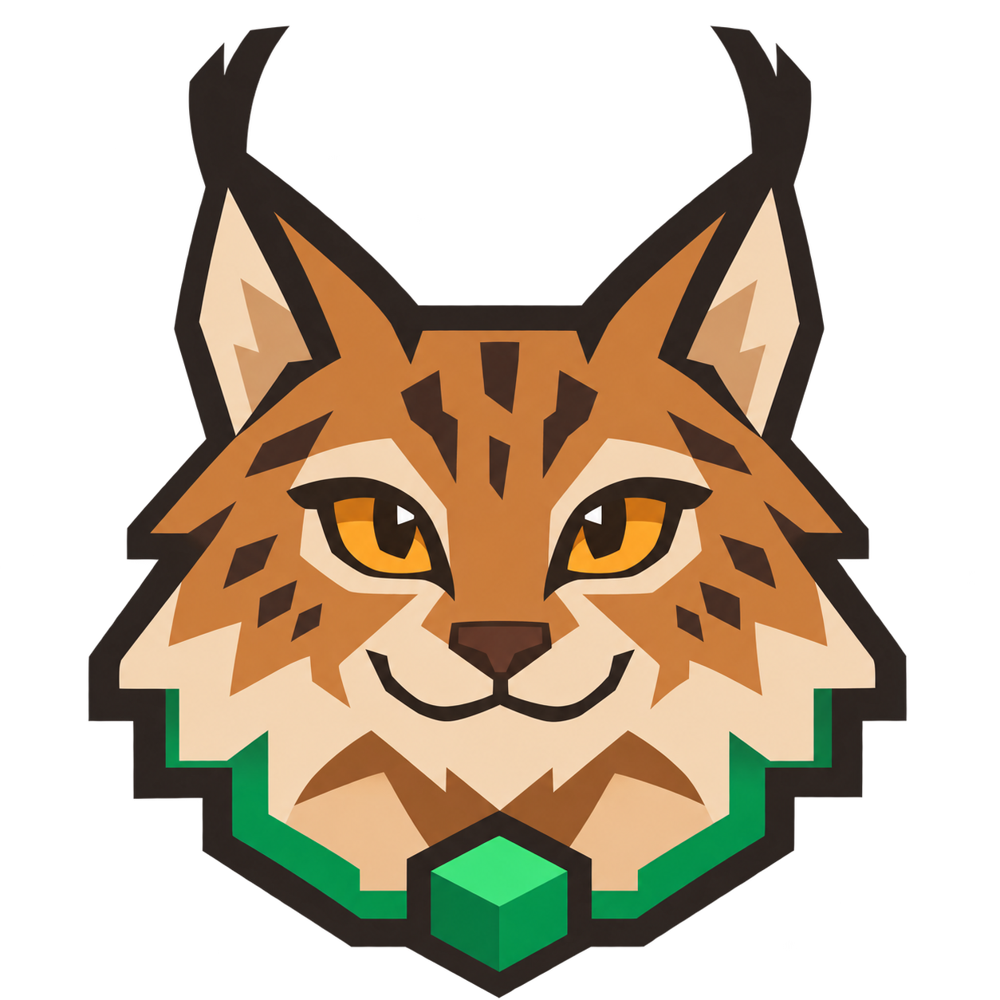

  

<h1 align="center">LinceLink</h1>

Share your Minecraft Java singleplayer world with a friend using an invite code.

  <a href="https://github.com/Alexandre1116/LinceLink/releases">Downloads</a> ·
  <a href="https://www.curseforge.com/minecraft/mc-mods/lincelink">CurseForge</a> ·
  <a href="#português">Português</a> ·
  <a href="docs/guia-detalhado.md">Detailed guide (PT)</a>

LinceLink is an experimental client mod that uses [Tailcat](https://github.com/tailscale/tailcat) to connect players. The host opens a singleplayer world and shares an invite; the guest pastes it into the multiplayer menu. Both players need the matching Minecraft version and LinceLink build. No Tailscale account is required.

## Supported versions

| Minecraft Java | Forge | Fabric | Java |
| --- | --- | --- | --- |
| 1.12.2 | ✓ | — | 8 |
| 1.16.5 | ✓ | ✓ | 8 |
| 1.18.2 | ✓ | ✓ | 17 |
| 1.20.1 | ✓ | ✓ | 17 |
| 1.21.1 | ✓ | ✓ | 21 |

Choose the JAR for your exact Minecraft version and loader; there is no universal JAR. Fabric builds also require [Fabric API](https://www.curseforge.com/minecraft/mc-mods/fabric-api). See the [compatibility matrix](docs/compatibilidade.md) for loader and dependency versions. Other Minecraft versions are not currently supported.

The owner has tested Forge 1.20.1 in game with a friend. The other builds and network conditions need further testing. Releases are experimental; CurseForge availability depends on its review process.

## Install and play

1. On **both computers**, install the matching Minecraft version, Forge or Fabric, and the corresponding LinceLink JAR from [GitHub Releases](https://github.com/Alexandre1116/LinceLink/releases). Place the JAR in the instance's `mods` folder. Fabric users must also install the matching Fabric API.
2. For **Forge 1.20.1**, LinceLink can download Tailcat v0.7.0 automatically on Windows and Linux x64/ARM64 when it is missing. Other builds and platforms need [Tailcat v0.7.0](https://github.com/tailscale/tailcat/releases/tag/v0.7.0) installed manually: put the executable in the instance's `tailcat` folder or on the system PATH. See the [detailed guide](docs/guia-detalhado.md) for paths and options.
3. The **host** opens a singleplayer world, pauses the game, selects **LinceLink**, starts sharing and sends the copied invite to the guest.
4. The **guest** opens **Multiplayer → LinceLink**, pastes the invite and joins. Keep the host's world open while playing.

Share the invite only with people you trust. Both sides should use the same mod version, and other installed content mods must be compatible. Remove any older `tailcatmod` JAR before installing LinceLink.

### Features on Forge 1.20.1

- Automatic Tailcat setup on supported platforms.
- Player ping and connection status (direct or DERP) in the Tab player list when the relevant information is available.
- Interface text follows the Minecraft language selection using the game's translations; technical names remain unchanged.

These extra features are currently specific to Forge 1.20.1. The other builds provide the core world-sharing flow. See the [detailed guide](docs/guia-detalhado.md) for connection states, language coverage and troubleshooting.

## Português

O LinceLink permite partilhar um mundo singleplayer do Minecraft Java com um amigo através de um convite, usando o Tailcat. Os dois jogadores precisam da mesma versão do Minecraft e do build correspondente do LinceLink. Não é necessária uma conta Tailscale.

1. Instala o Forge ou Fabric, o JAR correto das [releases](https://github.com/Alexandre1116/LinceLink/releases) e, no caso do Fabric, a [Fabric API](https://www.curseforge.com/minecraft/mc-mods/fabric-api). Ambos os jogadores devem instalar os ficheiros na pasta `mods` da sua instância.
2. No Forge 1.20.1, o Tailcat pode ser instalado automaticamente em Windows e Linux x64/ARM64. Nos restantes builds ou plataformas, instala manualmente o [Tailcat v0.7.0](https://github.com/tailscale/tailcat/releases/tag/v0.7.0), conforme o [guia detalhado](docs/guia-detalhado.md).
3. O anfitrião abre um mundo, pausa o jogo, escolhe **LinceLink**, inicia a partilha e envia o convite ao amigo.
4. O convidado abre **Multiplayer → LinceLink**, cola o convite e entra. O anfitrião mantém o mundo aberto.

A tabela acima mostra as versões disponíveis. O Forge 1.20.1 inclui também ping e estado de ligação no Tab e interface adaptada ao idioma do Minecraft. Os builds são experimentais: o proprietário testou o Forge 1.20.1 com um amigo; as restantes versões e condições de rede precisam de mais testes.

## Development and publishing

Build instructions, troubleshooting and transport details are in the [detailed guide](docs/guia-detalhado.md). The [CurseForge automation guide](curseforge/AUTOMATION.md) explains how GitHub releases are sent to CurseForge. Bugs and feedback are welcome through [GitHub Issues](https://github.com/Alexandre1116/LinceLink/issues).

## License and acknowledgements

LinceLink is open source under the [MIT License](LICENSE). It uses [Tailcat](https://github.com/tailscale/tailcat) as its transport and is not an official Tailscale project. Minecraft is a trademark of Mojang Studios; this project is not affiliated with Mojang or Microsoft.
