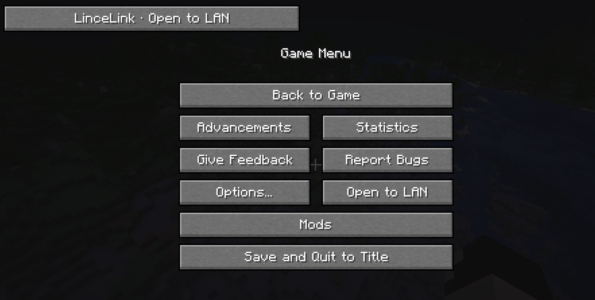
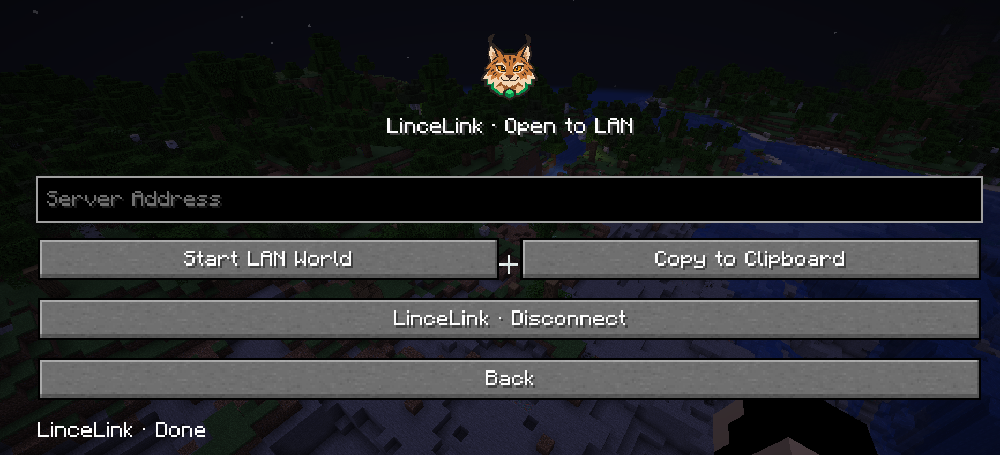
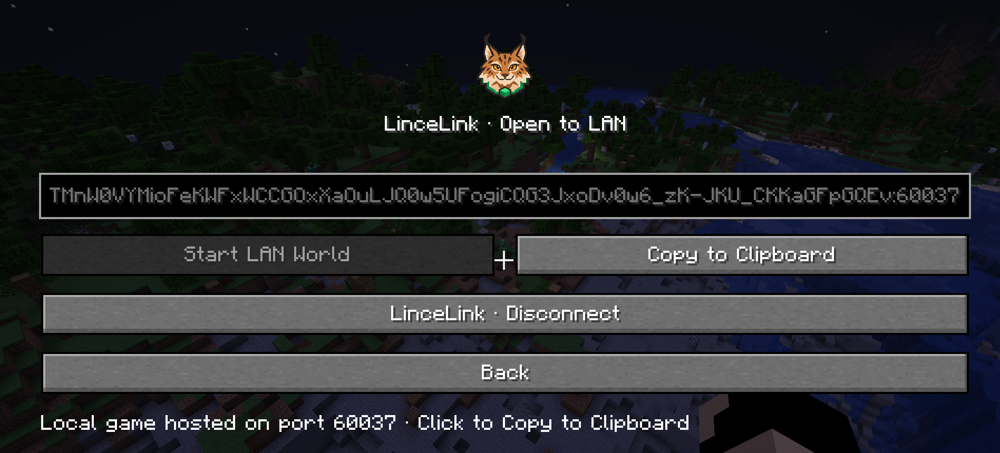
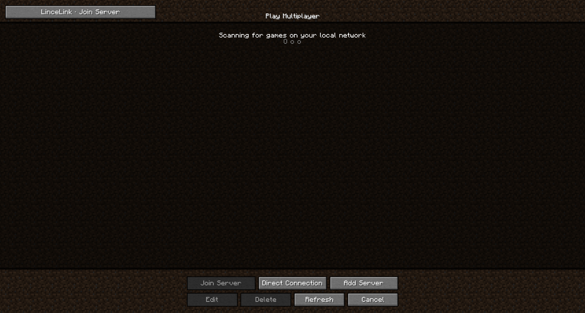
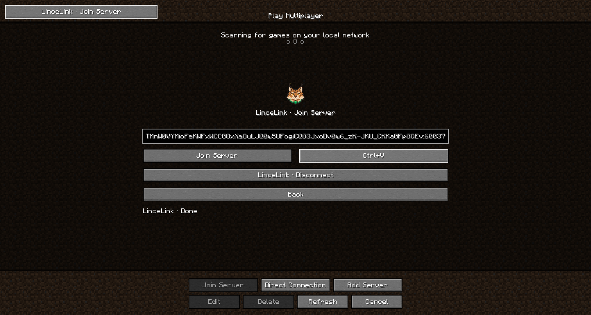
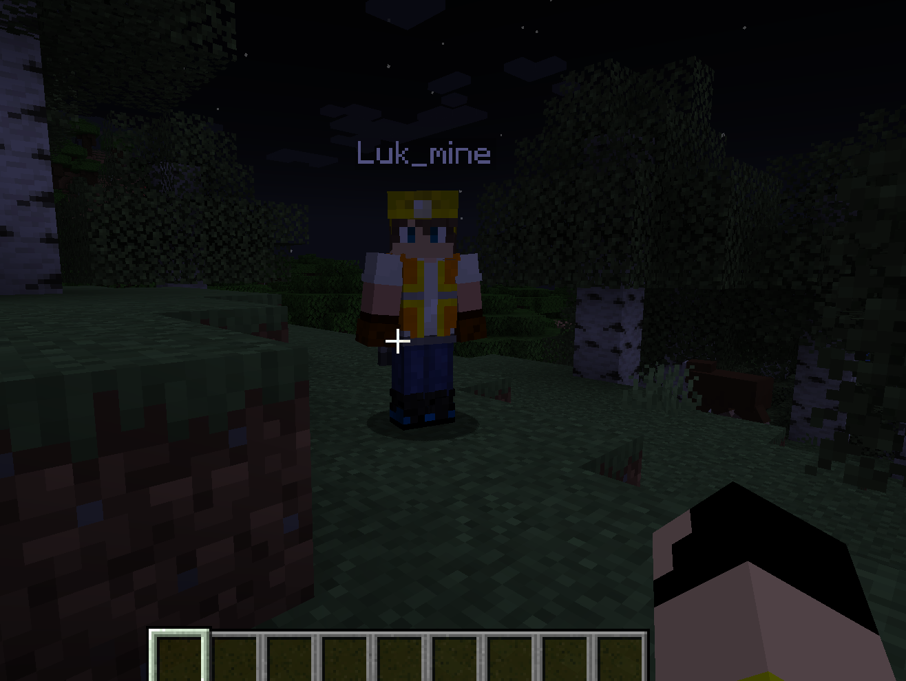
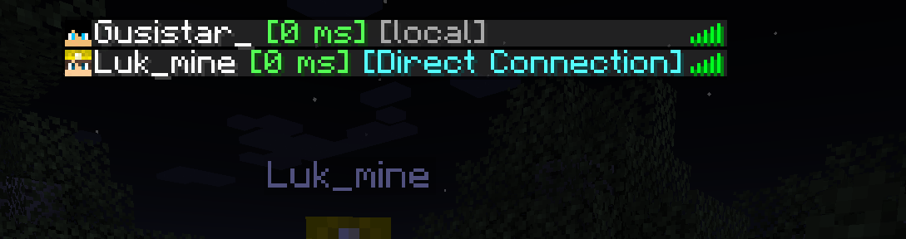
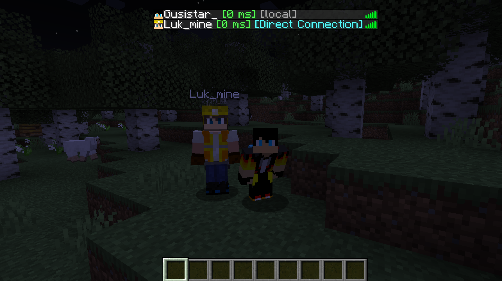

  

<h1 align="center">LinceLink</h1>

Share your Minecraft Java singleplayer world with a friend using an invite code.

  <a href="https://github.com/Alexandre1116/LinceLink/releases">Downloads</a> ·
  <a href="https://www.curseforge.com/minecraft/mc-mods/lincelink">CurseForge</a> ·
  <a href="#português">Português</a> ·
  <a href="docs/guia-detalhado.md">Detailed guide (PT)</a>

LinceLink is an open-source client mod that uses [Tailcat](https://github.com/tailscale/tailcat) to connect players. The host opens a singleplayer world and shares an invite; the guest pastes it into the multiplayer menu. Both players need the matching Minecraft version and LinceLink build. No Tailscale account is required.

**Dedicated server support is experimental and available for Forge 1.20.1.** Other server-side versions are coming soon.

## Supported versions

| Minecraft Java | Forge | Fabric | NeoForge | Java |
| --- | --- | --- | --- | --- |
| 1.12.2 | ✓ | — | — | 8 |
| 1.16.5 | ✓ | ✓ | — | 8 |
| 1.18.2 | ✓ | ✓ | — | 17 |
| 1.20.1 | ✓ | ✓ | Coming soon | 17 |
| 1.21.1 | ✓ | ✓ | ✓ | 21 |

Choose the JAR for your exact Minecraft version and loader; there is no universal JAR. Fabric builds also require [Fabric API](https://www.curseforge.com/minecraft/mc-mods/fabric-api). See the [compatibility matrix](docs/compatibilidade.md) for loader and dependency versions. Other Minecraft versions are not currently supported.

LinceLink 0.2.0 is the first normal release. Focused checks covered world hosting and invitation creation on selected builds. Connection with a second Minecraft client was not part of this release's testing; the project owner plans to test it with friends. See [validation notes](docs/validation-working.md) for the exact scope and untested flows. CurseForge files remain subject to its review process.

## Install and play

1. On **both computers**, install the matching Minecraft version, Forge, Fabric or NeoForge, and the corresponding LinceLink JAR from [GitHub Releases](https://github.com/Alexandre1116/LinceLink/releases). Place the JAR in the instance's `mods` folder. Fabric users must also install the matching Fabric API.
2. All supported builds can download Tailcat v0.7.0 automatically on Windows and Linux x64/ARM64 when it is missing. On other operating systems, install [Tailcat v0.7.0](https://github.com/tailscale/tailcat/releases/tag/v0.7.0) manually: put the executable in the instance's `tailcat` folder or on the system PATH. See the [detailed guide](docs/guia-detalhado.md) for paths and options.
3. The **host** opens a singleplayer world, pauses the game, selects **LinceLink**, starts sharing and sends the copied invite to the guest.
4. The **guest** opens **Multiplayer → LinceLink**, pastes the invite and joins. Keep the host's world open while playing.

Share the invite only with people you trust. Both sides should use the same mod version, and other installed content mods must be compatible. Remove any older `tailcatmod` JAR before installing LinceLink.

### Features on Forge 1.20.1

- Automatic Tailcat setup on supported platforms.
- Player ping and connection status (direct or DERP) in the Tab player list when the relevant information is available.
- Interface text follows the Minecraft language selection using the game's translations; technical names remain unchanged.

Ping, route status and the 145-language interface are specific to Forge 1.20.1. Other builds have English and Portuguese UI; other Minecraft languages fall back to English. See the [detailed guide](docs/guia-detalhado.md) for connection states, language coverage and troubleshooting.

## Screenshots

These screenshots show the Forge 1.20.1 interface and a multiplayer test.

| Opening a world | Sharing an invite |
| --- | --- |
|  |  |
| Pause menu | Host screen before sharing |
|  |  |
| Invite ready to copy | Multiplayer menu |
|  |  |
| Joining with an invite | A guest joins the world |
|  |  |
| Ping and connection status | Playing together |

## Português

O LinceLink permite partilhar um mundo singleplayer do Minecraft Java com um amigo através de um convite, usando o Tailcat. Os dois jogadores precisam da mesma versão do Minecraft e do build correspondente do LinceLink. Não é necessária uma conta Tailscale.

**Suporte experimental para servidor dedicado disponível em Forge 1.20.1.** As restantes versões para servidor estão previstas.

1. Instala o Forge, Fabric ou NeoForge, o JAR correto das [releases](https://github.com/Alexandre1116/LinceLink/releases) e, no caso do Fabric, a [Fabric API](https://www.curseforge.com/minecraft/mc-mods/fabric-api). Ambos os jogadores devem instalar os ficheiros na pasta `mods` da sua instância.
2. Todos os builds suportados podem instalar automaticamente o Tailcat v0.7.0 em Windows e Linux x64/ARM64. Noutros sistemas operativos, instala manualmente o [Tailcat v0.7.0](https://github.com/tailscale/tailcat/releases/tag/v0.7.0), conforme o [guia detalhado](docs/guia-detalhado.md).
3. O anfitrião abre um mundo, pausa o jogo, escolhe **LinceLink**, inicia a partilha e envia o convite ao amigo.
4. O convidado abre **Multiplayer → LinceLink**, cola o convite e entra. O anfitrião mantém o mundo aberto.

A tabela acima mostra as versões disponíveis. O Forge 1.20.1 inclui também ping e estado de ligação no Tab e interface nas 145 línguas. As restantes versões têm a interface em inglês e português; outros idiomas usam inglês. O LinceLink 0.2.0 é a primeira versão normal. Foram feitos testes focados de abertura de mundo e criação de convite em builds selecionados. A ligação com um segundo cliente não fez parte dos testes desta versão; o proprietário planeia testá-la com amigos. Consulta as [notas de validação](docs/validation-working.md) para ver o âmbito e os percursos por testar.

## Development and publishing

### Commands (Forge 1.20.1)

The singleplayer world owner or a server operator can use `/lincelink start` to open access, `/lincelink invite` to display a clickable invite, `/lincelink status` to check the tunnel and `/lincelink stop` to close it. On a dedicated server these commands are also available from the console without the slash. Invitations are private: share them only with intended players. Starting in singleplayer opens the built-in LAN server; stopping the tunnel does not close LAN until the world is exited. Dedicated server support remains experimental.

Build instructions, troubleshooting and transport details are in the [detailed guide](docs/guia-detalhado.md). The [CurseForge automation guide](curseforge/AUTOMATION.md) explains how GitHub releases are sent to CurseForge. Bugs and feedback are welcome through [GitHub Issues](https://github.com/Alexandre1116/LinceLink/issues).

## License and acknowledgements

LinceLink is open source under the [MIT License](LICENSE). It uses [Tailcat](https://github.com/tailscale/tailcat) as its transport and is not an official Tailscale project. Minecraft is a trademark of Mojang Studios; this project is not affiliated with Mojang or Microsoft.

Special thanks to [LukMine2008](https://github.com/LukMine2008) for being part of the testing team and helping test LinceLink.
